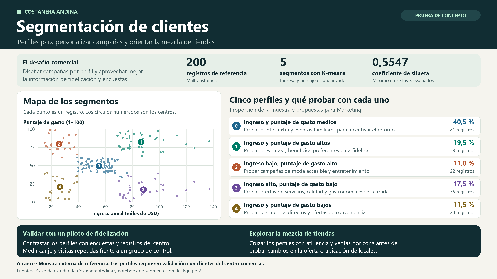

# Segmentación de clientes de Costanera Andina

**Equipo 2 · Diego Améstica, Agustín Cáceres y Gino Andrades**  
Gestión de Proyecto de Datos

Costanera Andina busca aprovechar la información de fidelización y encuestas para personalizar sus campañas y orientar la oferta de tiendas. Esta prueba de concepto aplica **K-Means** a **200 registros de referencia** y obtiene **cinco segmentos** según el ingreso anual y el puntaje de gasto. El grupo más numeroso presenta valores medios en ambas variables y representa el **40,5 % de la muestra**.

[Ver el notebook](notebooks/Clustering_CostaneraAndina_Equipo2.ipynb) · [Consultar el caso de negocio](reports/Contexto%20del%20Negocio/03_Segmentacion_Clientes_Centro_Comercial.docx) · [Descargar la infografía](images/extras/Infografia_Segmentacion_Costanera_Andina.png)



## 1. Problema de negocio y objetivos

El centro comercial realiza campañas generales y carece de una segmentación formal que ayude a decidir qué beneficios ofrecer, a quién dirigirlos y cómo ajustar la oferta comercial. El objetivo del proyecto es identificar grupos interpretables y convertir sus diferencias en propuestas que Marketing, Fidelización y Administración puedan evaluar.

El proyecto documenta la calidad de la muestra, construye y evalúa un modelo de agrupamiento, caracteriza sus segmentos y exporta los resultados para su revisión. La aplicación comercial requiere validar los perfiles con datos del centro.

## 2. Datos y análisis exploratorio

- **Fuente.** [Mall Customers.xlsx](data/raw/Mall%20Customers.xlsx) es una muestra externa de 200 registros usada como prueba de concepto. El notebook verifica su integridad mediante SHA-256.
- **Variables del modelo.** Ingreso anual en miles de dólares y puntaje de gasto de 1 a 100. El puntaje representa un índice, por lo que las diferencias entre segmentos se expresan en puntos.
- **Calidad y preparación.** Se retiró el identificador directo `CustomerID` de la matriz de análisis, se conservaron dos valores atípicos de ingreso y se documentaron las categorías `Unknown` en educación (13 %) y estado civil (7,5 %). 
- **Hallazgo exploratorio.** La correlación lineal entre ingreso y puntaje de gasto fue cercana a cero (`r ≈ 0,01`). El análisis conjunto de ambas variables permitió distinguir perfiles con ingresos similares y puntajes de gasto muy distintos. Las variables demográficas quedaron reservadas para describir y revisar los grupos.

## 3. Metodología CRISP-DM

| Fase | Trabajo realizado |
| --- | --- |
| Comprensión del negocio | Se tradujeron las necesidades de personalización y oferta comercial en un problema de segmentación. |
| Comprensión de los datos | Se verificó la fuente y se analizaron distribuciones, correlaciones, valores faltantes y observaciones atípicas. |
| Preparación | Se separaron las variables de contexto y se aplicó un pipeline de imputación preventiva y estandarización. |
| Modelado | Se ajustó K-Means sobre ingreso anual y puntaje de gasto estandarizados. |
| Evaluación | Se comparó la inercia de 1 a 10 grupos y la silueta de 2 a 10 grupos. |
| Preparación para el despliegue | Se exportaron el preprocesador, el modelo, las tablas y los gráficos. Se demostró la asignación de grupos con 20 registros sintéticos. |

El método del codo y el mayor coeficiente de silueta de la [evaluación](data/segmentation/evaluacion_kmeans.csv) coincidieron en **K = 5**. La solución alcanzó una **silueta de 0,5547** y una **inercia de 65,57** en la muestra. El notebook utiliza PCA para visualizar los grupos. Los dos componentes conservan el 100 % de la varianza porque la entrada tiene dos variables.

## 4. Resultados y propuestas por segmento

Los valores de ingreso y puntaje corresponden a los [centroides en escala original](data/segmentation/centroides_originales.csv). Las proporciones se calculan sobre los [200 registros segmentados](data/segmentation/resultado_segmentacion.csv).

| Grupo | Registros | Muestra | Ingreso anual (miles de USD) | Puntaje de gasto | Perfil y propuesta para Marketing |
| :--- | ---: | ---: | ---: | ---: | :--- |
| **0** | 81 | 40,5 % | 55,3 | 49,5 | **Ingreso y puntaje medios.** Probar puntos extra y eventos familiares para incentivar nuevas visitas. |
| **1** | 39 | 19,5 % | 86,5 | 82,1 | **Ingreso y puntaje altos.** Probar preventas y beneficios preferentes para fidelizar. |
| **2** | 22 | 11,0 % | 25,7 | 79,4 | **Ingreso bajo y puntaje alto.** Probar campañas de moda accesible y entretenimiento. |
| **3** | 35 | 17,5 % | 88,2 | 17,1 | **Ingreso alto y puntaje bajo.** Probar ofertas centradas en servicios, conveniencia y gastronomía especializada. |
| **4** | 23 | 11,5 % | 26,3 | 20,9 | **Ingreso y puntaje bajos.** Probar descuentos directos y ofertas de conveniencia. |

En la muestra, los grupos 1 y 3 tienen ingresos medios comparables y una diferencia de **65 puntos** en el puntaje de gasto. Esto permite formular propuestas distintas de fidelización y activación para perfiles con ingresos similares.

## 5. Validación y decisiones comerciales

1. **Validar los perfiles.** Contrastar los segmentos con registros de fidelización y encuestas de Costanera Andina. Revisar su estabilidad y representatividad antes de aplicar campañas.
2. **Medir un piloto de fidelización.** Probar beneficios por perfil y comparar la tasa de canje y las visitas repetidas frente a un grupo de control.
3. **Evaluar la mezcla de tiendas.** Cruzar los perfiles con afluencia y ventas por zona antes de plantear cambios en la oferta o la ubicación de los locales.

Los porcentajes describen la muestra externa. Cualquier estimación de impacto comercial requiere datos operativos y una evaluación del piloto.

## 6. Estructura del repositorio

```text
Proyecto Gestion/
├── README.md                                  Informe y guía de entrada
├── data/
│   ├── raw/                                   Mall Customers.xlsx
│   ├── processed/                             Datos preparados en CSV
│   └── segmentation/                          Resultados, centroides, métricas y pruebas sintéticas
├── images/
│   ├── extras/                                Infografía para presentación
│   └── modelo_segmentacion/                   Codo, silueta, centroides y gráficos PCA
├── models/
│   └── Segmentacion_modelo/                    Preprocesador, K-Means, PCA y metadatos
├── notebooks/
│   └── Clustering_CostaneraAndina_Equipo2.ipynb
└── reports/
    └── Contexto del Negocio/                   Documento del caso
    └── Informe_Segmentacion_Costanera_Andina      Informe de Segmentación (PDF y DOCX)
```

## 7. Cómo reproducir el análisis

El notebook utiliza Python, pandas y NumPy para preparar los datos, scikit-learn para el agrupamiento, Matplotlib y Seaborn para los gráficos y joblib para exportar los artefactos.

1. Abre el [notebook](notebooks/Clustering_CostaneraAndina_Equipo2.ipynb) en Jupyter o Google Colab.
2. Si usas un entorno local, instala las dependencias en el entorno del notebook.

   ```bash
   python -m pip install jupyter pandas numpy openpyxl requests scikit-learn matplotlib seaborn joblib
   ```

3. Ejecuta las celdas en orden. La carga definida en el notebook requiere conexión a internet para descargar y verificar el Excel de referencia.
4. Revisa las métricas y la asignación de grupos. Las celdas de exportación generan `archivos_segmentacion/` y su ZIP en el directorio de trabajo. Los resultados organizados para consulta se encuentran en [data/segmentation](data/segmentation/), [models/Segmentacion_modelo](models/Segmentacion_modelo/) e [images/modelo_segmentacion](images/modelo_segmentacion/).
